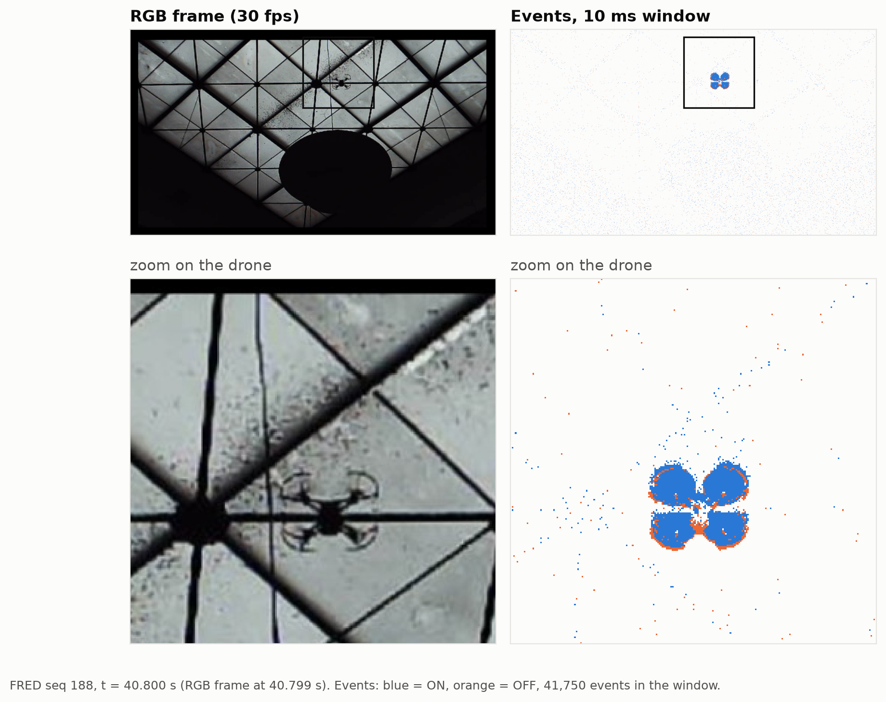
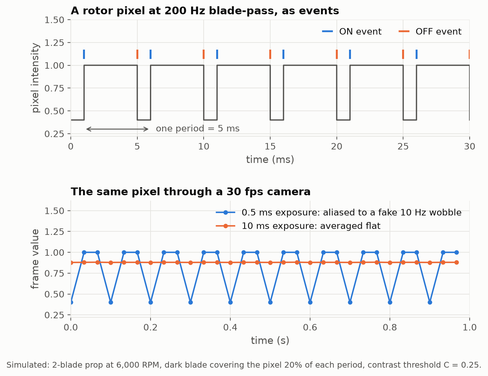
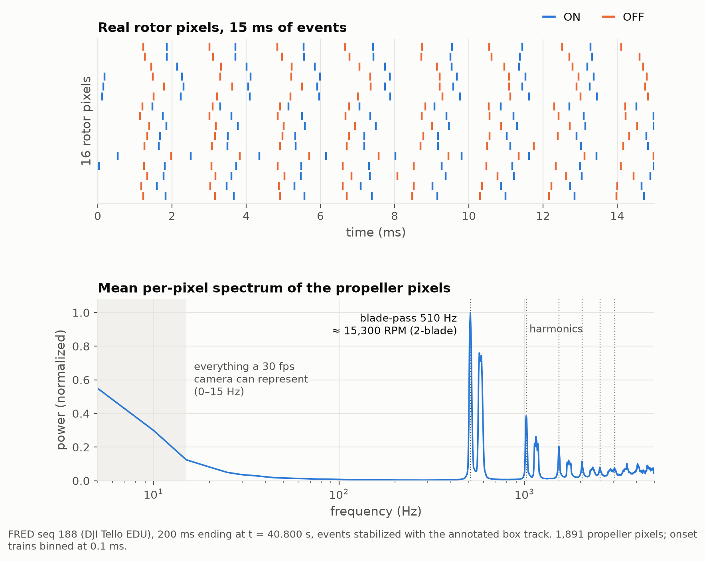
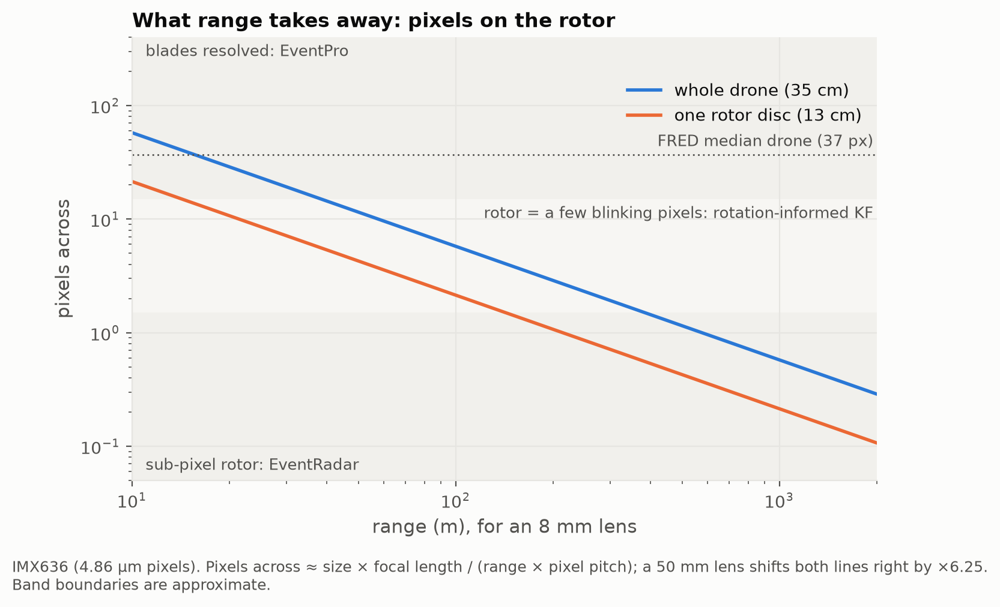
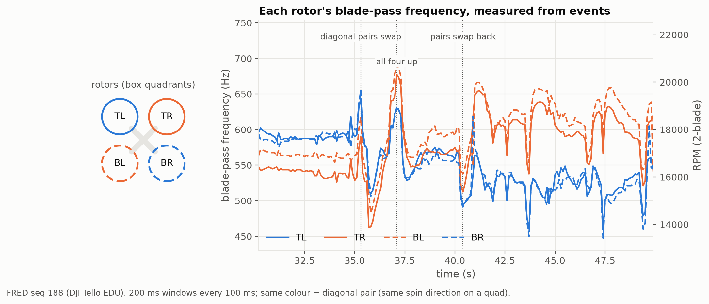
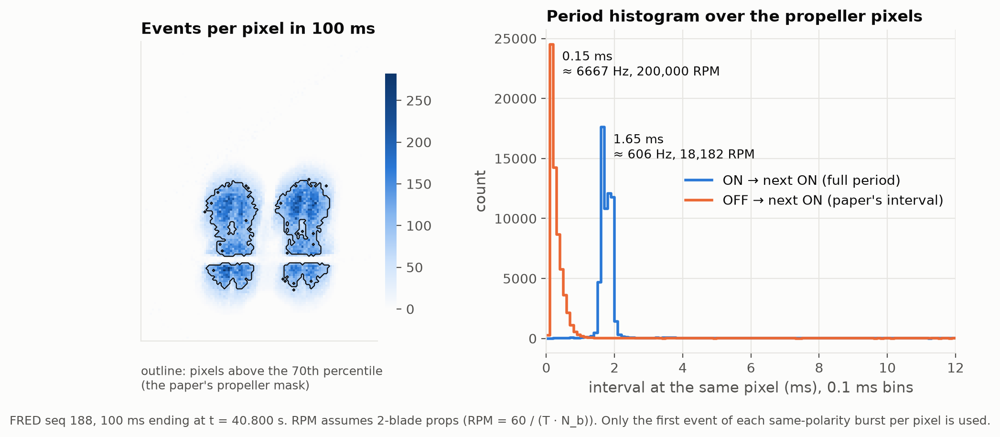

<!-- Edit this file in a plain-text editor (VS Code etc.), not OnlyOffice: a word-processor round-trip
     strips HTML comments, front matter and headings, and can escape LaTeX.
     Math: $...$ inline, $$...$$ display. Needs MathJax/KaTeX enabled in the site generator. -->

<!-- All media is pre-rendered offline by demos/ (see Appendix). Embed pattern for every clip:
<video src="media/NAME.mp4" poster="media/NAME.png" autoplay muted loop playsinline width="100%"></video>

Caption. FRED seq N, t = a–b s. Events binned at X ms, shown at Y× speed.

-->

<!-- HERO VIDEO: media/hero_rgb_vs_events.mp4 (Demo 1). Same 2 s of a FRED night/rain clip, RGB | events. -->

## 0. Drone Detection is Hard but Probably Worth It

Objects that are comparatively easy to detect and track using visual data often have:

1. Large bodies
2. High-contrast features
3. Slow, simple or otherwise predictable motion paths

In other words, they produce different data than the background; they are statistically “rare” by your measurements of choice. Imagine you wanted to do some damage to something remotely and inexpensively with a physics package of some kind. If you don’t want anyone to stop you, you might strap your physics package to something that is:

1. As small as possible
2. Visually uninteresting
3. Fast, and capable of complex and erratic motion paths

This object often ends up being a drone in practice, whether a fixed-wing, n-rotor, or hybrid. The people responsible for preventing these drones from damaging things have struggled to do so in recent times as these weaponized drones have become more common. Despite the drones usually being rather fragile and easy to dispatch *provided you have a tight confidence interval on where it will go*, the formation of that confidence interval is a very difficult problem to solve with conventional sensors. Radar exists, but also inherently reveals the location of the friendly radar system, which is often very inconvenient; non-emitting detection and tracking is usually preferable if not necessary. Passive detection with microphones can be too laggy; the speed of sound can’t be ignored when drones move at 0.01 to 0.1 times the speed of sound, and becomes very unreliable when stifled by unknown variable (in space and time) wind velocities (https://drone-warfare.com/counter-uas/acoustic-detection/). This leaves passive light-based detection as the only reasonable option when emission isn’t possible and wind isn’t controlled (i.e., the drone is outdoors, which is almost always).

## 1. The quick on EBS

Supposing you take my word that passive visual sensing is the ideal modality for drone detection and tracking, I’ll now introduce you to a sensor class that you probably didn’t think about when I first posed the problem: event-based vision sensors, also known as neuromorphic cameras (which, in my opinion, is a terrible misnomer).

### From integrating light to reporting change

Start with the camera you already know. Each pixel of a conventional CMOS sensor is a photodiode that converts incoming photons into a photocurrent $i_{\text{ph}}(t)$. During an exposure window of length $T_{\text{exp}}$ the pixel *integrates* that current into charge, and the readout chain digitizes the result:

$$
I_{\text{frame}}(\mathbf{x}) \;\propto\; \int_{t_0}^{t_0 + T_{\text{exp}}} i_{\text{ph}}(\mathbf{x}, t)\, dt .
$$

Then every pixel is read out, whether or not anything changed, once per frame period $1/f_s$. Three properties follow directly from that design:

- **Anything that moves during $T_{\text{exp}}$ is smeared.** Integration is a box filter in time, and that's where motion blur comes from.
- **Dynamic range is capped by the integrator.** The bright end is limited by the pixel's full-well capacity and the dark end by read noise. A typical frame camera gets roughly 60 dB ([Gallego et al.](https://arxiv.org/abs/1904.08405)).
- **Bandwidth is fixed at $W \times H \times f_s$ samples per second**, and almost all of them describe an unchanged sky.

An event-based vision sensor (EBS, also DVS for *dynamic vision sensor*) keeps the photodiode but changes everything after it ([Lichtsteiner et al., 2008](https://doi.org/10.1109/JSSC.2007.914337)). Each pixel has three stages:

1. **A logarithmic photoreceptor** that continuously outputs a voltage proportional to $\ln I$. There's no exposure window and no integration-and-reset. The log compression is where the huge dynamic range comes from: equal *ratios* of light produce equal voltage steps, whether the scene is at 1 lux or 100,000 lux.
2. **A differencing circuit** that remembers the log intensity at the moment the pixel last fired and tracks how far the current value has drifted from it.
3. **Two comparators** that trip when that drift exceeds a positive (ON) or negative (OFF) threshold. When one trips, the pixel emits an *event* and resets its reference to the current level.

Pixels that see no change say nothing. Pixels that fire request the shared output bus through an arbiter, an asynchronous scheme called *address-event representation* (AER). The readout stamps each event with a microsecond timestamp and packs the stream into a compact binary format. FRED's recordings, for example, use Prophesee's EVT 3.0, which encodes the time and row once and then sends vectors of events from neighbouring pixels. Bandwidth now scales with *how much the scene changes*, not with resolution × frame rate.

### The output, mathematically

Let $L(\mathbf{x}, t) = \ln I(\mathbf{x}, t)$ be the log intensity at pixel $\mathbf{x} = (x, y)^\top$. Pixel $\mathbf{x}_k$ emits an event at time $t_k$ when the log intensity has changed by the contrast threshold $C$ since that pixel's previous event at $t_k - \Delta t_k$:

$$
\Delta L(\mathbf{x}_k, t_k) \;=\; L(\mathbf{x}_k, t_k) - L(\mathbf{x}_k, t_k - \Delta t_k) \;=\; p_k\, C,
\qquad p_k \in \{+1, -1\}.
$$

The camera's entire output is the event stream

$$
\mathcal{E} = \{\, e_k = (x_k,\, y_k,\, t_k,\, p_k) \,\}_{k=1}^{N},
$$

ordered by time. Each event says *where*, *when*, and *which direction*. That's all. There's no absolute brightness: the sensor reports changes in log intensity, and anything that should look like a picture has to be rebuilt from them. A few practical details matter later:

- $C$ is not identical across pixels. It varies from pixel to pixel and drifts with temperature and bias settings, so "one event = exactly $C$" is an idealization.
- After firing, a pixel ignores input for a short *refractory period*. Even a fast edge produces a burst of a few events, not an infinite stream.
- Real streams contain noise: background-activity events (worse in low light), "hot" pixels that fire constantly, and flicker from artificial lighting. Every paper below spends real effort filtering this out.

### What's on the market

Specs from manufacturer documentation. Read the caveats under the table before comparing columns.

| Sensor (example kit) | Resolution | Pixel pitch | Dynamic range | Pixel latency | Timestamp resolution | Notes |
|---|---|---|---|---|---|---|
| **Sony/Prophesee IMX636** (EVK4 HD) | 1280 × 720 | 4.86 µm | >86 dB (5 lux–10 klux); >120 dB (80 mlux–100 klux) | <100 µs at 1000 lux; <1 ms at 5 lux | 1 µs | Nominal contrast threshold 25%. **Used by FRED, EventPro and EventRadar.** |
| **Prophesee GenX320** | 320 × 320 | 6.3 µm | >120 dB (newer briefs: >140 dB) | <150 µs at 1000 lux; <1 ms at 5 lux | 1 µs | Ultra-low power (~3 mW typical), aimed at embedded devices |
| **iniVation DVXplorer** | 640 × 480 | 9 µm | ~90–110 dB (depends on test conditions) | <1 ms typical | — | Up to 165 Mev/s |
| **iniVation DAVIS346** | 346 × 260 | 18.5 µm | ~120 dB (events); 55 dB (its frame output) | <1 ms typical | 1 µs | Also outputs conventional frames from the same pixels; up to 12 Mev/s |
| *Typical frame camera* | — | — | ~60 dB | one frame period + exposure | one frame period (e.g. 33 ms at 30 fps) | for reference |

How to read these numbers:

- **"Dynamic range" for an event camera means something different.** It's the range of *illumination levels* over which the pixel still detects contrast changes, not the signal-to-noise ratio of a single image. That's why Prophesee gives two ranges with lux limits, and why the figure rises when the low end is pushed into near-darkness, where noise dominates.
- **Latency depends on illumination.** The photoreceptor is slower in the dark, so the IMX636 goes from about 100 µs at 1000 lux to about 1 ms at 5 lux.
- **Latency and timestamp resolution are different things.** The clock is 1 µs, but the pixel itself takes ~0.1–1 ms to respond. Timing *between* events at the same pixel is still very precise, and that's what the rest of this post relies on.

Sources: [IMX636 product brief](https://prophesee.ai/wp-content/uploads/2024/05/IMX636-Product-Brief-2024-v3.0.pdf), [EVK4 HD manual](https://prophesee.ai/wp-content/uploads/2023/01/EVK4-HD-Prophesee-Evaluation-Kit-Camera-Manual-1.1.pdf), [GenX320 brief](https://prophesee.ai/wp-content/uploads/2025/01/GENX320-Product-Brief-2025-DICE-OK.pdf), [iniVation DAVIS346 docs](https://docs.inivation.com/hardware/current-products/davis346.html), [iniVation DVXplorer guide](https://docs.inivation.com/_static/hardware_guides/dvxplorer.pdf).

<!-- FIG: figures/pixel_model.svg (log photoreceptor → differencing → comparators → AER). -->

*The same instant in RGB and in a 10 ms slice of events (FRED seq 188). The airframe barely registers in the events; the four spinning rotors light up.*

<!-- VIDEO: media/xyt_rotate.mp4 + FIG: figures/xyt_drone_crop.png (Demo 1): x-y-t cloud of a FRED drone crop. -->

## 2. EBS vs RGB for Drones

Why do conventional cameras struggle so much with drones? Go back to the list in section 0. A drone is small, low-contrast and fast, and each of those properties attacks a different part of the frame-camera pipeline.

**It's small.** A drone with span $D$ at range $R$, viewed through a lens of focal length $f$ onto pixels of pitch $p$, covers roughly

$$
n_{\text{px}} \;\approx\; \frac{D\, f}{R\, p}
$$

pixels across. Take a 35 cm quadcopter, an 8 mm lens and the IMX636's 4.86 µm pixels: that's $n_{\text{px}} \approx 576 / R$ pixels with $R$ in metres. So about 6 px at 100 m, and less than one pixel at 600 m. Even a 50 mm lens only gives ~4 px at 1 km. A learned detector has almost no appearance to work with at that size, and a 4 px dark blob looks the same whether it's a drone, a bird or a speck of dust on the lens. In FRED, the dataset used for this post's demos, the median drone is only **~37 px** across (√(w·h) over all 694k boxes).

**It's low-contrast, and the lighting is often hostile.** Drones are often seen against a bright sky (so they're backlit and dark), against cluttered treelines, or at dusk. A 60 dB frame camera has to pick an exposure: expose for the sky and the drone is a silhouette with no internal detail; expose for the drone and the sky clips. In low light the camera lengthens $T_{\text{exp}}$, which makes the next problem worse.

**It's fast.** Image-plane motion during the exposure is smeared over

$$
b \;\approx\; \lvert \mathbf{u} \rvert\, T_{\text{exp}}
$$

pixels, where $\mathbf{u}$ is the image velocity in px/s. Take the same quadcopter crossing at 15 m/s at 100 m through the 8 mm lens: it moves about 250 px/s on the sensor. With a 10 ms exposure that's 2.5 px of blur on a 6 px target. At dusk, with a 33 ms exposure, the blur (≈8 px) is *larger than the drone*. The signal is spread across more pixels, and the peak contrast that a detector depends on drops accordingly.

**It changes direction between frames.** At 30 fps, a manoeuvring drone has 33 ms between observations to do something unexpected. The tracker's latency is at least a frame period plus the exposure, before any processing.

**The camera wastes almost all its bandwidth.** Of the ~$28 \times 10^6$ pixel values per second that a 30 fps 720p stream produces, the drone accounts for a few hundred per frame. Everything else is sky.

The event camera changes each of these trade-offs:

- **A static background goes quiet.** With a fixed camera, unchanging sky and buildings generate (almost) no events, so a moving drone stands out against a nearly empty background instead of a full image of clutter.
- **There's no exposure window to blur across.** An edge produces events at the moment it crosses each pixel, timestamped to the microsecond. You can choose the time-bin width *after* recording.
- **The log response handles backlighting and dusk** far better than a fixed exposure can.
- **Even a hovering drone keeps firing.** Its body may sit still, but its propellers never stop. That leads to section 3.

It isn't free. A camera that only sees change goes blind to anything stationary relative to it. It's flooded with events when the *camera* moves (section 4.3). It gets noisy in very low light. And it gives no colour or texture for a classifier to use. The papers below are largely about turning those weaknesses into features.

<!-- HERO / comparison: media/hero_rgb_vs_events.mp4 can be referenced again here with a caption pointing out blur and dynamic range. -->

## 3. Frequency and Drones

There's one thing every multirotor does, all the time, that birds, clouds and swaying branches don't: it spins propellers at a nearly constant, very high rate.

As a propeller with $N_b$ blades turns at $\text{RPM}$ revolutions per minute, a pixel looking at the propeller disc sees a blade edge pass over it at the **blade-pass frequency**

$$
f_{\text{bp}} \;=\; \frac{N_b \cdot \text{RPM}}{60}.
$$

Typical flight speeds of 2,000–10,000 RPM ([EventPro](https://arxiv.org/abs/2511.13100)) on two-blade propellers give $f_{\text{bp}} \approx 67\text{–}333$ Hz. Small FPV props spin considerably faster. Each time a dark blade crosses a pixel against a brighter sky, the log intensity drops (OFF events) and then recovers (ON events). So the pixel's event stream is a **pulse train with period $1/f_{\text{bp}}$**: a few milliseconds.

**A frame camera can't see this.** At $f_s = 30$ fps the Nyquist limit is 15 Hz, so a 200 Hz blade-pass signal aliases to

$$
f_{\text{alias}} \;=\; \bigl| f_{\text{bp}} - \operatorname{round}(f_{\text{bp}} / f_s)\, f_s \bigr| \;=\; |200 - 210| \;=\; 10\ \text{Hz},
$$

a slow wobble that has nothing to do with the true speed. In practice, it's worse than aliasing. A 10 ms exposure integrates two full blade passes, so the propeller is averaged into a translucent disc and the modulation mostly disappears before it's sampled at all. An event pixel has a 1 µs clock and a response time of ~0.1–1 ms, so a 5 ms period is easy to resolve. Measuring time *between* events is exactly what the sensor is good at.

**The signal is a pulse train, not a sine wave.** A blade covers a pixel for only part of each period, so the pixel signal is periodic but sharply non-sinusoidal. Its Fourier series has energy at the fundamental *and* at its harmonics:

$$
s(t) \;=\; \sum_{h=1}^{\infty} a_h \cos\!\left(2\pi h f_{\text{bp}}\, t + \phi_h\right).
$$

That detail sounds pedantic, but it's central to how EventRadar works at long range (section 4.3).

**The frequency carries physics, not just identity.** A propeller spinning at angular speed $\omega_i$ (rad/s) produces thrust and reaction torque that grow with its square,

$$
T_i = \kappa_f\, \omega_i^2, \qquad \tau_i = \kappa_\tau\, \omega_i^2 ,
$$

with $\kappa_f, \kappa_\tau$ set by the propeller and the air density. In a hover, the total thrust balances the weight, $\sum_i \kappa_f \omega_i^2 = mg$. Any deviation from the hover speeds is the flight controller commanding an acceleration. So propeller speed is not just a fingerprint: it's a direct, slightly early readout of the forces about to act on the vehicle. The three papers below use it at increasing levels of detail.

***Note: It isn't a unique signature.*** *Bird wingbeats are mostly well below 30 Hz, but many insects beat their wings at 100–600 Hz, right in the propeller band (FRED even includes insects as distractors). Frequency alone doesn't settle it; it must be combined with spatial context.*

*Simulated: one pixel under a 2-blade propeller at 6,000 RPM. The event camera reports every blade passage (top). A 30 fps camera either aliases it to a fake 10 Hz wobble or averages it away (bottom).*

*The same thing on real data (FRED seq 188, a DJI Tello EDU). Top: 16 rotor pixels fire a burst of OFF then ON events at every blade passage, roughly every 1.8 ms. Bottom: averaged over 1,891 propeller pixels, the spectrum has sharp blade-pass peaks near 510 and 570 Hz (two, because the rotors aren't all at the same speed; see section 4.1) plus their harmonics. The shaded band is everything a 30 fps camera can represent.*
<!-- FIG: figures/rotor_freq_heatmap.png + VIDEO: media/rotor_clock.mp4 (Demo 2). -->

## 4. Range and Event Generation

To see why each technique below works at a different range, go back to the event-generation equation and ask what a *scene* change does to it. Assume brightness constancy: a scene point keeps its brightness while its image moves with velocity $\mathbf{u}(\mathbf{x})$ (px/s). Over a short interval $\Delta t$ the log intensity at a fixed pixel then changes by

$$
\Delta L(\mathbf{x}) \;\approx\; -\,\nabla L(\mathbf{x}) \cdot \mathbf{u}(\mathbf{x})\, \Delta t ,
$$

so a pixel fires when an intensity *gradient* moves *across* it. The number of events an edge of log-contrast $\Delta L_{\text{edge}}$ leaves at each pixel it crosses is about $|\Delta L_{\text{edge}}|/C$. The total event rate over a region is roughly

$$
\dot{N} \;\approx\; \frac{1}{C}\sum_{\mathbf{x} \in \Omega} \bigl|\nabla L(\mathbf{x}) \cdot \mathbf{u}(\mathbf{x})\bigr| .
$$

Now apply this to a propeller at increasing range $R$. Two things scale with range, and one doesn't:

- **Image size scales as $1/R$.** A rotor of radius $r_p$ covers about $2 r_p f / (R p)$ pixels across, so the number of pixels it touches falls as $1/R^2$.
- **Per-pixel contrast collapses once the blade is smaller than a pixel.** Then the blade covers only a fraction $a < 1$ of the pixel's footprint. If the blade has relative contrast $c$ against the background, the pixel sees a change of only $\Delta L \approx \ln(1 + a\,c)$ instead of $\ln(1 + c)$. With the IMX636's 25% threshold, a dark blade must cover something like a third to a half of the pixel before it reliably fires at all. (This is a back-of-the-envelope estimate, ignoring optics blur and atmospheric turbulence, which only make it worse.)
- **The blade-pass frequency doesn't depend on $R$ at all.** It's set by the motor, not by the optics.

So as range grows, the propeller signal doesn't change *frequency*. It loses *spatial support* and *signal-to-noise ratio*. That gives three regimes, and each paper sits in one:

| Regime | Rotor on sensor | What the events look like | What you can measure | Paper |
|---|---|---|---|---|
| Near (≲ 60 m) | blades resolved (tens of px) | blade edges sweeping in visible arcs | angular velocity of **each** propeller | EventPro |
| Mid (FRED) | a few px per rotor, drone ~25–45 px | flickering blobs; blades not resolved | one dominant **period per drone** | Rotation-informed KF |
| Far (0.7–1.5 km) | sub-pixel to a few px for the *whole drone* | a weak, sparse, drifting pulse train | "is there a propeller frequency here?" plus a frequency estimate | EventRadar |

*How many pixels a 35 cm drone and one 13 cm rotor cover as range grows (IMX636, 8 mm lens). The regimes are set by pixels on the rotor, so a longer lens just slides the lines to the right.*

### 4.1 Near: EventPro

[EventPro](https://arxiv.org/abs/2511.13100) (Chen, Xu et al.) is built for a cooperative, close-range problem: guiding a delivery drone onto a landing pad from a ground-mounted event camera in its last ~50 m. Close up, the blades are resolved, so EventPro can measure each propeller separately and then turn those measurements into commands and state.

#### Count Every Rotation: measuring each propeller's speed

1. *Filter and segment.* Events in a short window are binned into coarse spatial cells (e.g. 5 × 5 px). Two maps are built: event count and fraction of ON events. A spinning blade produces many events with roughly balanced polarity. Background noise is sparse and tends to be one-sided. Cells failing either test are discarded. The surviving events are clustered with K-means, with $K$ equal to the number of propellers. The cluster centroids give the rotor centres.

2. *Contrast maximization with a rotational warp.* Put the origin at a rotor centre. If the propeller spins at angular velocity $\omega$, an event at $(\mathbf{x}_k, t_k)$ was produced by a blade edge that, at a reference time $t_{\text{ref}}$, sat at

   $$
   \mathbf{x}'_k \;=\; \mathbf{R}\!\left(-\,\omega\,(t_k - t_{\text{ref}})\right)\mathbf{x}_k,
   \qquad
   \mathbf{R}(\theta) = \begin{bmatrix} \cos\theta & -\sin\theta \\ \sin\theta & \cos\theta \end{bmatrix}.
   $$

   Undo the rotation for every event and build an image of where the warped events land, $H(\mathbf{x};\omega) = \sum_k \delta(\mathbf{x} - \mathbf{x}'_k)$. With the correct $\omega$, all the events from a blade pile up on a sharp image of that blade. With the wrong $\omega$ they spread out into a smeared disc. EventPro scores the warped image $h_{ij}$ with two rewards:

   $$
   R(\omega) \;=\; \underbrace{\sum_{i,j} e^{\,h_{ij}}}_{\text{accumulation}} \;+\; \underbrace{\sum_{i,j} \frac{1}{e^{\,h_{ij}} - 1 + \epsilon}}_{\text{sparsity}} .
   $$

   The accumulation term rewards tall piles. The sparsity term is dominated by the empty pixels (each contributes $\approx 1/\epsilon$), so in effect it counts empty pixels and rewards a compact image. That's what separates the correct $\omega$ from nearly-correct values that pile up almost as well. Because the search is one-dimensional, Brent's method finds the maximum quickly.

3. *Adaptive batching.* The warp assumes constant $\omega$ within a batch. EventPro grows each batch from short time slices and stops adding slices when a new slice, warped with the current $\omega$, scores differently from the last one by more than a set fraction (0.3 in the paper). That indicates the speed has changed. It also caps the batch size and samples events in proportion to local density, which keeps the cost bounded when a nearby drone generates more than $10^4$ events per millisecond.

#### Every Rotation Counts: from speeds to state

Section 3's physics is used directly. For a multirotor, the collective thrust and body torques are linear in the *squared* rotor speeds:

$$
T = \kappa_f \sum_i \omega_i^2, \qquad
\tau_\phi \propto \kappa_f \ell \Bigl(\sum_{\text{left}} \omega_i^2 - \sum_{\text{right}} \omega_i^2\Bigr), \qquad
\tau_\theta \propto \kappa_f \ell \Bigl(\sum_{\text{front}} \omega_i^2 - \sum_{\text{rear}} \omega_i^2\Bigr), \qquad
\tau_\psi \propto \kappa_\tau \Bigl(\sum_{\text{CW}} \omega_i^2 - \sum_{\text{CCW}} \omega_i^2\Bigr),
$$

with arm length $\ell$; the signs depend on convention. Each basic manoeuvre therefore leaves its own pattern across the rotors: all rotors up to climb, one side up for a roll, diagonal pairs split for a yaw. EventPro uses this in two stages:

- **Infer the command.** Over a short window, each rotor's $\omega_i^2(t)$ is low-pass filtered and summarized by five features: mean, standard deviation, dominant frequency, spectral energy and spectral entropy. An SVM classifies the window as hover, yaw, roll, pitch, climb or descend. That's deliberately lightweight: it avoids identifying $\kappa_f$ and $\kappa_\tau$ for an unknown airframe.
- **Use the command as a motion prior.** An LSTM encoder–decoder takes the one-hot command $\mathbf{u}_t$, the rotor speeds $\omega^{1:N_p}_t$ and the past trajectory $X_{1:t}$, and predicts the next positions. An extended Kalman filter uses that prediction as its *process model* and the drone's GPS as its *measurement*:

$$
\boldsymbol{\mu}^{p}_{t} = \text{LSTM}(\mathbf{u}_t, \omega^{1:N_p}_t, X_{1:t}), \qquad
\boldsymbol{\mu}_{t} = \boldsymbol{\mu}^{p}_{t} + K_t\bigl(\mathbf{z}^{\text{GPS}}_t - H\boldsymbol{\mu}^{p}_{t}\bigr).
$$

The idea is that the propellers show what the controller *just decided*, before the position measurement can register the change.

*The motor-mixing physics, measured from a FRED camera rather than a lab rig. Each quadrant of the drone's box holds one rotor; its blade-pass frequency comes from the same per-pixel spectrum as in section 3, in sliding 200 ms windows. The diagonal pairs (same colour) move together and swap order at ~35 s and ~40 s, the pattern of a yaw. Around 37 s all four rise together, the pattern of a climb. This uses per-pixel frequency, not EventPro's contrast-maximization warp, but it shows that the per-rotor signal EventPro builds on is there in FRED's footage.*

#### Reported results

- Rotor-speed error: 0.23% RMAE indoors and 0.31% outdoors, against a laser tachometer and a motor encoder respectively.
- Latency: about 3 ms end to end, one to three orders of magnitude faster than the Ev-Tach and EEPPR baselines.
- Command inference: 96.5% precision.
- Localization: more than 22% better when fused with other sensors (0.15 m error in vertical flights, 0.87 m in spirals).

#### Caveats

- **Range and view angle are hard limits.** Accuracy degrades with distance (tested to 60 m) and once the view angle is past ~40°. The method needs blades you can actually see.
- **The tracking stage is cooperative.** It fuses the *drone's own GPS*, which is fine for landing assistance but not available against a hostile drone.
- **The command classifier is small-scale.** It was trained on 200 samples per manoeuvre for one airframe.
- **It mostly won't transfer to FRED.** FRED's median drone is ~37 px across, so blades are rarely resolved. Our demo uses the closest sequences to show where the warp still works and where it fails.

<!-- FIG: figures/cmax_landscape.png + VIDEO: media/cmax_sweep.mp4 (Demo 5): R(ω) landscape and the warped event image as ω sweeps through the optimum. -->

### 4.2 Mid: Rotation-informed KF

At FRED's distances the blades merge into a few flickering pixels per rotor. You can't warp individual blades any more, but every rotor pixel still blinks at the blade-pass period. [S.M., Habibiroudkenar et al.](https://arxiv.org/abs/2603.01997) take that single number and use it where a Kalman filter is weakest: deciding how much to trust its own motion model.

#### The baseline filter

The drone is tracked in the image plane with a constant-velocity state $\mathbf{x} = (c_x, c_y, v_x, v_y)^\top$:

$$
F(\Delta t) = \begin{bmatrix} 1 & 0 & \Delta t & 0 \\ 0 & 1 & 0 & \Delta t \\ 0 & 0 & 1 & 0 \\ 0 & 0 & 0 & 1 \end{bmatrix}, \qquad
\hat{\mathbf{x}}_{k|k-1} = F\,\hat{\mathbf{x}}_{k-1|k-1}, \qquad
P_{k|k-1} = F P_{k-1|k-1} F^\top + Q_k .
$$

Each new measurement $\mathbf{z}_k$ (here box centre and finite-difference velocity, so $H = I_4$) corrects the prediction:

$$
K_k = P_{k|k-1} H^\top \bigl(H P_{k|k-1} H^\top + R\bigr)^{-1}, \qquad
\hat{\mathbf{x}}_{k|k} = \hat{\mathbf{x}}_{k|k-1} + K_k\bigl(\mathbf{z}_k - H \hat{\mathbf{x}}_{k|k-1}\bigr), \qquad
P_{k|k} = (I - K_k H)\, P_{k|k-1}.
$$

Forecasting is then just predicting without updating. The filter's current state is pushed forward in 33 ms steps out to 0.4 s and 0.8 s, $\hat{\mathbf{x}}_{t+\tau} = F(\tau)\,\hat{\mathbf{x}}_{t|t}$. The forecast is only as good as the velocity estimate at time $t$.

#### Why the process noise is the right thing to adapt

The process noise $Q$ is the filter's assumption about how far the true state can drift from constant velocity between steps. In the standard white-noise-acceleration model,

$$
Q = \sigma_a^2\, G G^\top, \qquad G = \begin{bmatrix} \tfrac{1}{2}\Delta t^2 & 0 \\ 0 & \tfrac{1}{2}\Delta t^2 \\ \Delta t & 0 \\ 0 & \Delta t \end{bmatrix},
$$

so $Q$ is literally an *acceleration variance*. A fixed $Q$ forces a compromise:

- **Small $Q$** gives a small Kalman gain and a smooth velocity estimate. The filter is great in a steady cruise but slow to notice a turn.
- **Large $Q$** gives a large gain. The filter follows every manoeuvre quickly but passes measurement noise straight into the velocity estimate, and therefore into the forecast.

Classical adaptive filters (innovation-based $Q$ estimation, interacting-multiple-model filters) choose between these regimes by watching the residuals, which means they react only *after* the drone has already deviated. Propeller speed is a cue *from outside the filter* that arrives *earlier*. Thrust is proportional to $\omega^2$ and acceleration follows thrust immediately. Position only shows the change two integrations later.

#### Measuring the RPM

Inside the drone's bounding box:

1. Count events per pixel to get a frequency map $F(x, y)$. Keep pixels above the 70th percentile as propeller pixels and discard the rest as airframe. A percentile threshold adapts automatically to lighting and speed.
2. For each propeller pixel, track its last ON and OFF timestamps. When an ON follows an OFF, record the interval $\Delta t$.
3. Collect the intervals from all pixels into a histogram $H(b)$ with bin width $\Delta b = 0.1$ ms over $[0, 25.6]$ ms (256 bins). Entries older than 100 ms are dropped (first in, first out).
4. Take the peak as the period and convert it to RPM:

$$
\hat{T} = \left(b^\ast + \tfrac{1}{2}\right)\Delta b, \quad b^\ast = \arg\max_b H(b), \qquad
\text{RPM} = \frac{60}{\hat{T}\, N_b}.
$$

#### Modulating the process noise

With $r \in [0, 1]$ the normalized RPM and $\dot{r} \in [-1, 1]$ its rate of change, the process noise is scaled by

$$
Q_k = \alpha_v\, Q_0, \qquad \alpha_v = \max\!\bigl(0.5,\; 1 + 2r + \max(0, \dot{r})\bigr).
$$

High sustained thrust or a throttle-up makes the filter trust the measurements more. Low, steady RPM (near hover) lets it lean on the smooth constant-velocity model. The $\max(0,\dot r)$ term is the "leading indicator" part: it raises $Q$ at the moment the motors spool up, before the box starts to move.

#### Reported results

FRED test split, with ground-truth boxes as measurements:

| Method | ADE 0.4 s | ADE 0.8 s | FDE 0.4 s | FDE 0.8 s |
|---|---|---|---|---|
| Linear extrapolation | 16.45 | 37.93 | 32.90 | 83.32 |
| Kalman filter (fixed $Q$) | 16.40 | 37.08 | 32.80 | 81.54 |
| **Kalman + RPM** | **15.35** | **34.85** | **31.16** | **77.76** |

Errors are in pixels. All three classical methods beat every deep-learning baseline from the FRED paper (LSTM, Transformer, CNN + Transformer, with RGB and/or events) by a wide margin.

#### Caveats

- **No detector in the loop.** The filter is fed ground-truth box centres and velocities differenced from ground truth, so this isolates forecasting from detection error. With a real detector, the gap might widen or shrink.
- **The gains are modest:** 1–2 px of ADE at 0.4 s and 2–4 px at 0.8 s. Our demo checks how consistent they are across sequences.
- **One RPM for the whole drone** throws away the left/right asymmetries that, in EventPro, encode *which way* it's about to go. The authors list per-rotor RPM as future work.
- **What the interval measures.** Implemented as described (OFF followed by ON at one pixel), the interval measures how long a blade covers that pixel, not the rotation period. On FRED seq 188 it peaks at 0.15 ms (an impossible ~200,000 RPM), while the full ON → ON period peaks cleanly at 1.65 ms (figure above). The authors' code may do something different from our reading of the text. The filter only uses normalized $r$ and $\dot r$, so a consistent scale factor matters less there, but absolute RPM values need the full period.
- **The paper's Table I is internally inconsistent.** In the deep-learning rows ADE is *larger* than FDE (e.g. LSTM 171.9 vs 53.04), the reverse of the classical rows. The columns may have been transposed, so check the FRED paper before quoting those baselines.

*The period histogram on a real FRED drone (seq 188, a DJI Tello EDU, 100 ms window). Measured ON → next ON at the same pixel, the propeller pixels cluster at 1.65–1.75 ms and ~1.9 ms, one cluster per diagonal rotor pair (section 4.1). That's 510–600 Hz blade-pass, or roughly 15,000–18,000 RPM for 2-blade props. The OFF → next ON gap instead peaks at 0.15 ms, which is how long a blade covers a pixel, not a rotation.*

<!-- FIG: figures/ade_fde_boxplots.png + VIDEO: media/forecast_overlay.mp4 (Demo 4): past / GT / forecast on RGB and event frames. -->

### 4.3 Far: EventRadar

At a kilometre or more, the whole drone is a handful of pixels, and a long lens gives a narrow field of view. To watch a useful slice of sky the camera has to *scan*. That creates a new problem before the propeller signal even enters the picture.

#### Why moving the camera floods the sensor

Go back to the event-rate approximation:

$$
\dot{N} \;\approx\; \frac{1}{C}\sum_{\mathbf{x}} \bigl|\nabla L(\mathbf{x}) \cdot \mathbf{u}(\mathbf{x})\bigr| .
$$

With a static camera, the background has $\mathbf{u} = \mathbf{0}$ and contributes nothing. Only moving objects (and noise) fire. Once the camera moves, *every* textured pixel in the scene gets a nonzero image velocity:

- **When the camera translates** with velocity $v$, a background point at depth $Z$ moves at $|\mathbf{u}| \approx f\,v / (p\,Z)$ px/s. Near objects move fastest, but everything moves.
- **When the camera rotates** (EventRadar's gimbal pans and tilts) at rate $\Omega$, the image velocity is $|\mathbf{u}| \approx f\,\Omega / p$ *regardless of depth*. The horizon, buildings, treelines and cloud edges all sweep across the sensor at the same speed. A long lens makes this worse, because $f$ multiplies the angular rate.

Every background edge now leaves $|\Delta L_{\text{edge}}|/C$ events at each pixel it crosses, for the whole duration of the scan. The scene the static camera ignored turns into millions of events per second of clutter. Somewhere inside them is a few-pixel drone producing a weak flicker. Detection with an event camera now has two problems: find *where* to look, and check *whether* it's a drone.

[EventRadar](https://arxiv.org/abs/2606.11285) (Zhou et al., from the same group as EventPro) handles these with two modules.

#### SAGE: where to look

*Scene-Anchored Geometry Evidence.* Background events move on the image plane during a scan, but they come from *fixed directions in the world*. SAGE uses the gimbal/IMU attitude to express every event in a world-fixed frame:

$$
\mathbf{p}_c = \frac{K^{-1} f_{\text{dist}}^{-1}(\mathbf{u})}{\lVert K^{-1} f_{\text{dist}}^{-1}(\mathbf{u}) \rVert_2},
\qquad
\mathbf{p}_s = R_t\, \mathbf{p}_c,
\qquad
\lambda = \operatorname{atan2}(p^s_x, p^s_z), \quad \varphi = \arcsin(-p^s_y).
$$

Here $K$ is the camera intrinsics matrix and $f_{\text{dist}}$ the lens-distortion model, so the first step turns each pixel into a unit viewing ray. The time-aligned camera-to-world rotation $R_t$ then turns that ray into a fixed *bearing*: azimuth $\lambda$ and elevation $\varphi$. Events are accumulated into a bearing-indexed angular memory. For each angular cell, SAGE tracks a **persistence ratio**: the fraction of recent short time bins in which that cell produced events.

- A swept building edge or horizon fires *every time* the scan passes, from the *same* bearing, so its persistence is high.
- A drone traces a continuous path *through* neighbouring bearings and stays at any one of them only briefly. It's spatially continuous but temporally transient.

Low-persistence, spatially coherent clusters become candidates $\mathcal{C}_t = \{(\Omega_m, \lambda_m, \varphi_m, b_m, t_m)\}$: an image region $\Omega_m$, its bearing, a box $b_m$ and a timestamp. SAGE doesn't decide whether a candidate is a drone; it decides what's worth checking.

#### CHG-LISTA: is it a drone?

*Comb-guided Harmonic-Group LISTA.* Within each candidate region, spatial structure is useless, so EventRadar discards it and keeps only timing. The events in $\Omega$ are binned into a count series

$$
s_\Omega[n] = \#\{\, e_i : (x_i, y_i) \in \Omega,\; t_i - t_0 \in [\,nT/N,\, (n+1)T/N\,) \,\}, \qquad n = 0, \dots, N-1 .
$$

At 1 km this series is a sparse, drifting pulse train with missed cycles and arbitrary phase. A plain FFT peak is unreliable here. The energy is split across harmonics (section 3), and the noise floor moves with scan speed and background activity. CHG-LISTA cleans the series up, then tests it against a *family* of harmonics at once:

1. **Remove slow drift.** Project out low-order polynomial trends (first order by default), $P_\perp = I - P(P^\top P)^{\dagger}P^\top$ with $P = [\mathbf{1}, \mathbf{t}, \dots, \mathbf{t}^q]$. Then normalize robustly:
   $$
   \mathbf{z} = \frac{\tilde{\mathbf{s}} - \operatorname{median}(\tilde{\mathbf{s}})}{1.4826\,\operatorname{MAD}(\tilde{\mathbf{s}}) + \epsilon}.
   $$
2. **Build a harmonic comb for each candidate frequency $f_j$.** Use a cosine–sine pair at the fundamental and its harmonics. The pair absorbs the unknown phase, and the $1/h$ weights stop the higher harmonics from dominating:
   $$
   D_j(t) = \bigl[\, w_h \cos(2\pi h f_j t),\; w_h \sin(2\pi h f_j t) \,\bigr]_{h \in \{1,2,3\}}, \qquad w_h = 1/h .
   $$
3. **Solve a group-sparse fit.** Explain the signal with as *few frequency groups* as possible. With a fixed sparse sketch $\Phi$ to cut the dimension ($\mathbf{y} = \Phi \mathbf{z}$, $A = \Phi D$):
   $$
   \min_X \; \tfrac{1}{2}\bigl\lVert \mathbf{y} - A \operatorname{vec}(X) \bigr\rVert_2^2 + \lambda \sum_{j=1}^{F} \lVert X_j \rVert_2 .
   $$
   The group penalty $\lVert X_j \rVert_2$ keeps or kills a candidate frequency *together with its harmonics*. A real propeller can win with a weak fundamental if its harmonics support it.
4. **Unroll the solver into a fixed number of layers.** Instead of iterating to convergence, which takes a data-dependent time, run $K$ iterations of ISTA as a small network with learned step sizes and thresholds (that's the "LISTA"):
   $$
   X^{k+1} = \eta_{\theta_k}\!\bigl(X^k + \alpha_k A^\top(\mathbf{y} - A\operatorname{vec}(X^k))\bigr), \qquad
   \eta_\theta(X_j) = \max\!\Bigl(1 - \frac{\theta_j}{\lVert X_j \rVert_2 + \epsilon},\, 0\Bigr) X_j .
   $$
   This bounds the compute per candidate, which matters for real-time operation. The dictionary starts as the exact comb and is fine-tuned to the sensor's real pulse shapes.
5. **Score the peak against its local background.** Group energies $r_j = \lVert X^K_j \rVert_2$ are compared to the average of nearby bins $n_j$ (excluding a small guard band), giving $c_j = r_j / (n_j + \epsilon)$. The verifier reports $\hat f = f_{\hat j}$ and confidence $\hat c = c_{\hat j}$ with $\hat j = \arg\max_j c_j$. A ratio is used rather than a raw peak because the absolute level shifts with range, sky region and scan speed.

The output is the cue a counter-UAS system actually needs: *a bearing, a box, a rotor-frequency estimate and a confidence*.

#### Reported results

On 700–1500 m recordings (DJI M30T and Mavic 3 Pro targets, IMX636 behind a long lens on a 2-DoF gimbal), EventRadar reaches 0.990 mAP@0.3 and 0.949 F1@0.3 with a 0.009 miss rate. The next-best event baseline (EV-SpSegNet) gets 0.814 F1. The spatial-cue baselines collapse at range: EvDetMAV reaches 0.25 F1 and EVPropNet 0.13, and the density-burst baseline (effqpdet) detects nothing.

#### Caveats

- **The two modules do different jobs.** In the default pipeline, boxes come from SAGE's proposals and the harmonic score *verifies* them; it isn't used to generate them. So the detection metrics measure the scene-memory proposals as much as the propeller cue.
- **Gimbal pose is required.** SAGE needs a known camera rotation; FRED's camera is static. In our demo $R_t = I$ and SAGE reduces to a background-persistence map, which is still useful against static clutter and flicker. Long range is emulated by pooling FRED pixels.
- **Weak labels come from the same frequency analysis.** The training labels are derived from it, so some circularity between labels and verifier is hard to rule out.

<!-- FIG: figures/fft_vs_comb_vs_range.png + VIDEO: media/harmonic_vs_range.mp4 (Demo 3): raw FFT vs comb vs group-ISTA confidence as effective range increases. -->

## 5. Putting it together

The three papers share one physical fact and differ mainly in how much of it the optics let through.

### Why each technique fits its range

The rotor frequency $f_{\text{bp}}$ doesn't depend on range. What range removes is the *spatial support* behind it (the rotor covers $\propto 1/R^2$ pixels) and then the *per-pixel contrast* (once a blade is smaller than a pixel, $\Delta L \approx \ln(1 + a\,c)$ approaches the threshold). Each method uses exactly as much structure as its range still provides:

- **Near: EventPro uses the geometry.** With blades resolved, events trace blade edges, and a rotational warp can find each propeller's $\omega_i$ to a fraction of a percent. Separate rotors mean separate $\omega_i^2$, and through the mixing relations, thrust and torques. That's enough to *name the manoeuvre*. Push it out to FRED-like ranges and the warp has no blade edges to sharpen.
- **Mid: the rotation-informed KF uses the period.** Blades blur into a few blinking pixels per rotor, but every such pixel still repeats with the blade-pass period. A histogram over all rotor pixels recovers one robust number, and a Kalman filter can use one number well: it sets how much acceleration to expect. You lose per-rotor asymmetry, so the frequency tells you *how lively* the drone is, not *which way* it's going.
- **Far: EventRadar uses the spectrum.** Below a few pixels, even individual pixels fire unreliably. The only way to recover the signal is to pool *everything*: all pixels in the region into one count series, and all harmonics into one comb. That's enough to answer "is this a propeller?" and to estimate its frequency, which is what a detector needs. The hard part moves to the *spatial* side: finding the region at all, while the scanning camera floods the sensor with background events.

### The pipeline they suggest

Ordered by range, the papers also line up as stages of one system:

1. **EventRadar** sweeps the sky, proposes bearings from scene-anchored persistence and confirms them by their harmonics.
2. Once a target is confirmed, the system stops scanning. A **rotation-informed tracker** then follows it, with RPM telling the filter when to expect manoeuvres.
3. As it closes, **EventPro-style** per-rotor speeds reveal the commands being flown, which is a direct read on intent.

The interesting failure points are the handoffs. EventRadar's gimbal motion is exactly what the static-camera tracker assumes away. The mid-range period histogram can't yet separate rotors. And EventPro's state estimator relied on the drone's own GPS, which a hostile drone won't share. None of the three papers bridges these handoffs.

### Shared blind spots
- **Rotor visibility.** All three assume the rotors can be seen: ducted or shrouded props, steep view angles and occlusion degrade every method.
- **Fixed-wing aircraft.** A single pusher prop is a weaker, often hidden signature, and none of the papers tests one.
- **Insects.** Insect wingbeats overlap the propeller band.
- **Evaluation.** Each paper evaluates on one dataset, and two of the three datasets are private.

Better learned priors aren't the obvious next step either: in the FRED results, every deep-learning forecaster lost to *linear extrapolation*. A benchmark spanning near to far, with per-rotor ground truth, would test all three ideas, and their handoffs, on the same data.

<!-- FIG: figures/ladder.svg (Demo 6): x = range, y = information extracted from rotation (periodic? → RPM → per-rotor ω → command). -->

## 6. Takeaways

## Appendix: Reproducing the figures and videos

<!-- Nothing in this post runs in the browser. Every video and figure was rendered offline from FRED. -->

### Environment

### Data

### Reading FRED's raw events

### One row per output

| Output | Script | Command | Runtime |
|---|---|---|---|
| | | | |

## References

- Zhou et al., *EventRadar: Long-Range Visual UAV Discovery through Spatiotemporal Event Sensing*, [arXiv:2606.11285](https://arxiv.org/abs/2606.11285), 2026.
- S.M., Habibiroudkenar et al., *Event-Only Drone Trajectory Forecasting with RPM-Modulated Kalman Filtering*, [arXiv:2603.01997](https://arxiv.org/abs/2603.01997), 2026.
- Chen, Xu et al., *Count Every Rotation and Every Rotation Counts: Exploring Drone Dynamics via Propeller Sensing*, [arXiv:2511.13100](https://arxiv.org/abs/2511.13100), 2025.
- Magrini et al., *FRED: The Florence RGB-Event Drone Dataset*, ACM MM 2025.
- Gallego et al., *Event-Based Vision: A Survey*, IEEE TPAMI 2022, [arXiv:1904.08405](https://arxiv.org/abs/1904.08405).
- Lichtsteiner, Posch & Delbruck, *A 128×128 120 dB 15 µs Latency Asynchronous Temporal Contrast Vision Sensor*, IEEE JSSC 2008, [doi:10.1109/JSSC.2007.914337](https://doi.org/10.1109/JSSC.2007.914337).
